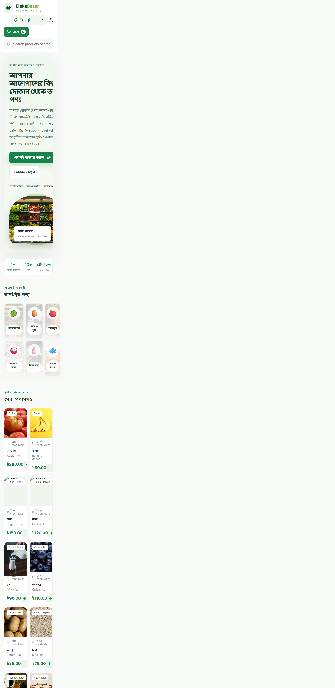
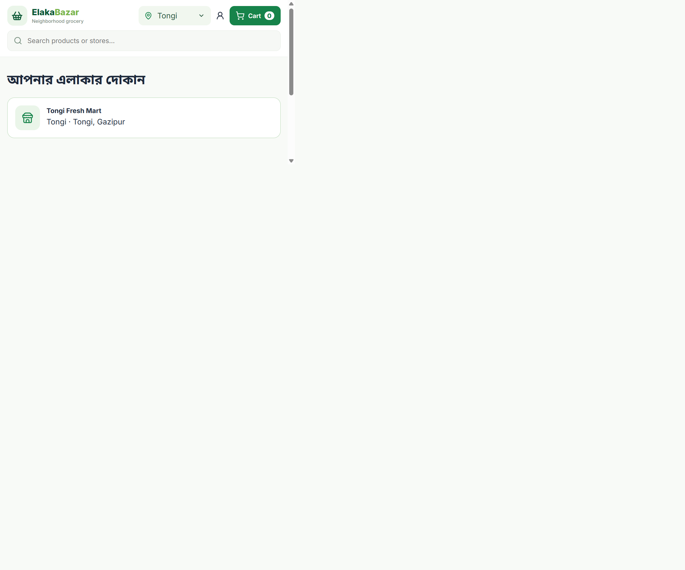
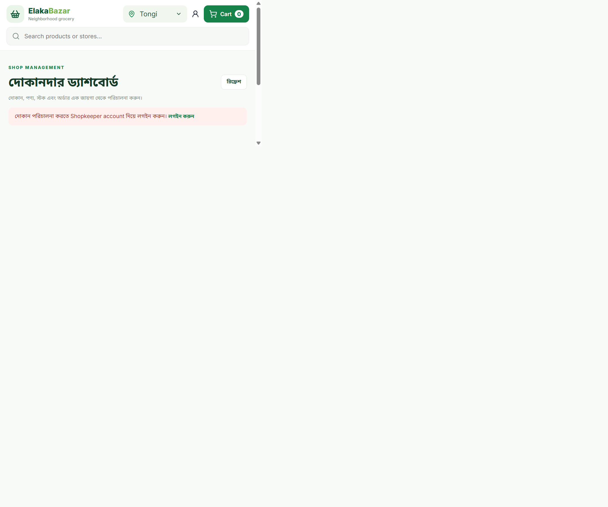

# ElakaBazar – Local Grocery Marketplace

ElakaBazar is a Bangladesh-focused local grocery marketplace that connects customers with nearby shops for fresh produce, household essentials, and daily groceries. The platform helps users discover local stores, browse products, place orders, and manage deliveries with a simple and reliable experience.

## Project Overview

- Local delivery marketplace for neighborhood groceries
- Customer-friendly storefront with category browsing and search
- Shopkeeper dashboard for inventory, pricing, and order management
- Role-based login for customers and shopkeepers
- Built for local area-based commerce in Bangladesh

## Screenshots

### Homepage



### Store listing



### Shopkeeper dashboard



## Features

- Search products by name, category, or shop
- Select different delivery areas
- Add products to cart and checkout with address selection
- Customer cart and order flow
- Shopkeeper product management and stock updates
- Order status updates for accepted, preparing, and ready states

## Project Structure

```text
ElakaBazar/
├─ backend/                     # Django + DRF backend
│  ├─ elakabazar/              # Project settings and URL config
│  ├─ marketplace/             # Stores, products, cart, auth, orders
│  ├─ manage.py
│  └─ requirements.txt
├─ frontend/                    # React + Vite + TypeScript frontend
│  ├─ src/
│  ├─ package.json
│  ├─ vite.config.ts
│  └─ index.html
├─ docker-compose.yml           # Local multi-service setup
├─ docs/                        # More project documentation
├─ mobile/                      # Mobile app codebase
├─ .env.example
├─ README.md
└─ .gitignore
```

## Getting Started

```bash
git clone https://github.com/Mausd34/ElakaBazar.git
cd ElakaBazar

# Start the stack with Docker
docker compose up --build
```

Then open:

- Frontend: `http://localhost:5173`
- Backend API: `http://localhost:8000/api/`

## Development Commands

```bash
# Frontend
cd frontend
npm install
npm run dev

# Backend
cd backend
python manage.py migrate
python manage.py runserver 0.0.0.0:8000
```

## Demo Access

Customer demo account:

- Phone: `01700000001`
- Password: `DemoPass123!`

Shopkeeper demo account:

- Phone: `01700000002`
- Password: `DemoPass123!`

## Tech Stack

| Layer | Technology |
|------|------------|
| Frontend | React, TypeScript, Vite |
| UI Styling | CSS modules and custom styling |
| Backend | Python, Django, Django REST Framework |
| Database | PostgreSQL |
| Auth | JWT-based role handling |
| Containerization | Docker Compose |

## License

MIT – Feel free to adapt and extend the project.
