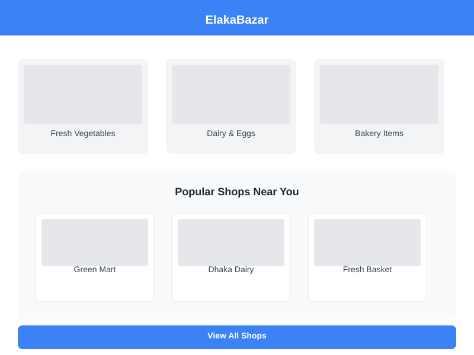
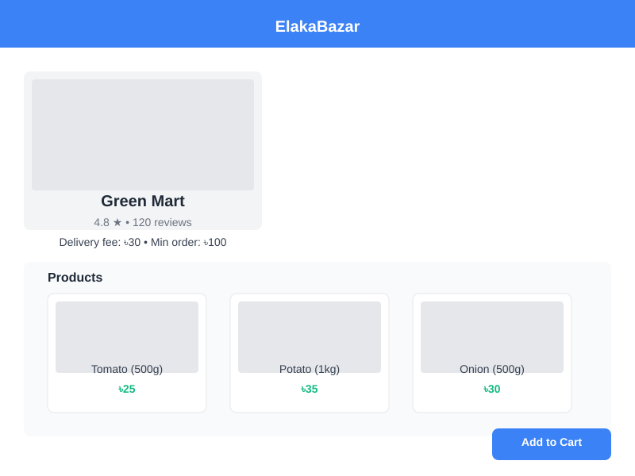
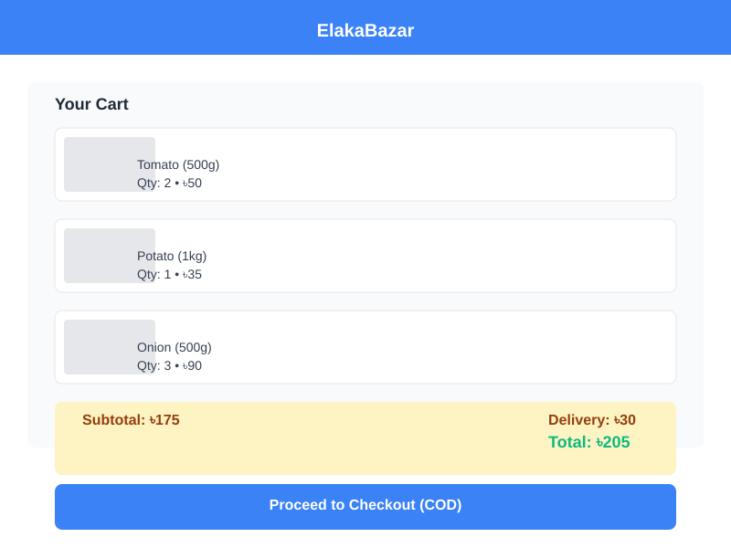
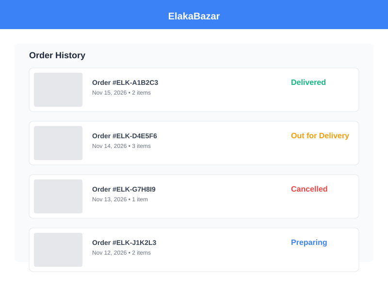
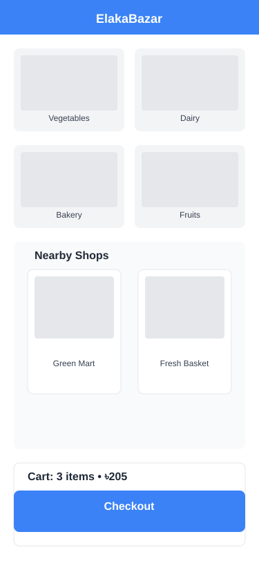
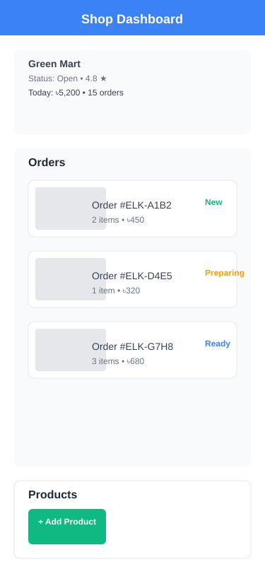
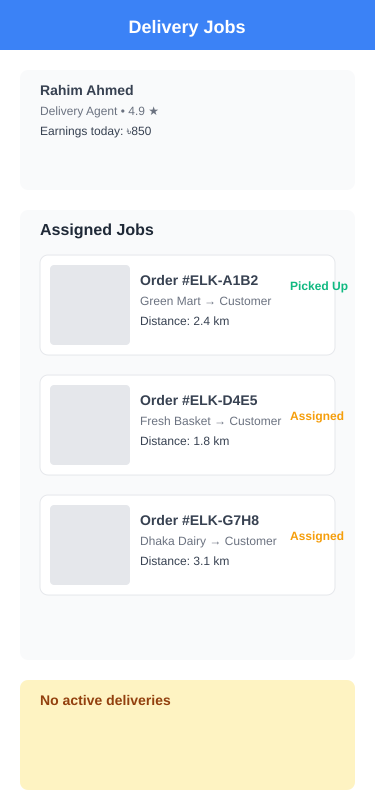
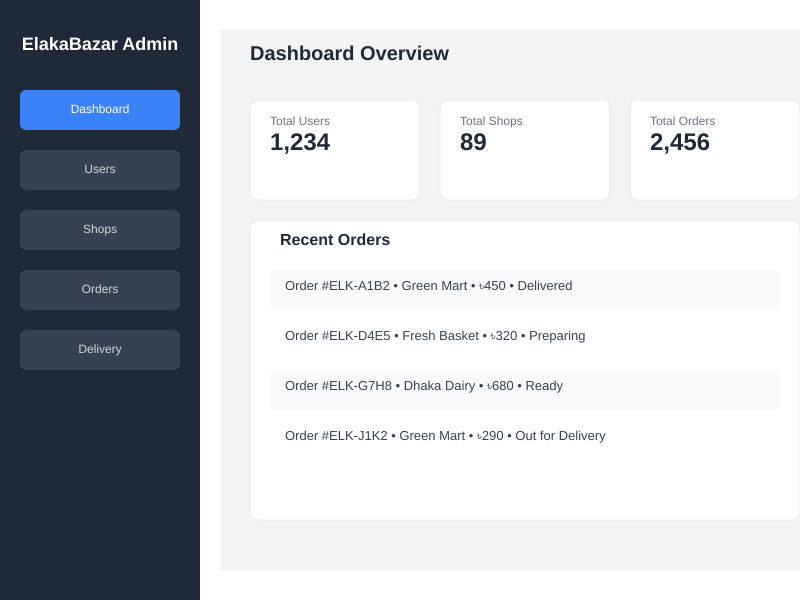

# ElakaBazar

> **Location-based grocery marketplace for Bangladesh** — connecting customers with neighborhood shops through a unified web and mobile experience.


> 📸 **Add your own banner:** Place a wide hero image (recommended 1200×300 px) at `assets/banners/hero.png`.


[](https://opensource.org/licenses/MIT)
[](https://www.djangoproject.com/)
[](https://reactjs.org/)
[](https://www.typescriptlang.org/)
[](https://expo.dev/)
[](https://www.postgresql.org/)
[](https://www.docker.com/)

---

## Table of Contents

- [Overview](#overview)
- [Screenshots & Demo](#screenshots--demo)
- [Key Features](#key-features)
- [Tech Stack](#tech-stack)
- [Project Structure](#project-structure)
- [Prerequisites](#prerequisites)
- [Quick Start (Docker)](#quick-start-docker)
- [Manual Setup](#manual-setup)
  - [Backend](#backend)
  - [Frontend (Web)](#frontend-web)
  - [Mobile (Expo)](#mobile-expo)
- [Environment Variables](#environment-variables)
- [API Documentation](#api-documentation)
- [Deployment](#deployment)
- [Contributing](#contributing)
- [License](#license)
- [Support](#support)

---

## Overview

**ElakaBazar** is a hyperlocal grocery marketplace designed for Bangladesh. Customers can browse nearby shops, discover products, manage a cart, and place cash-on-delivery orders. Shopkeepers manage their inventory and fulfill orders, while delivery agents handle pickups and drop-offs. Admins oversee users, shops, and deliveries.

The platform is built as a monorepo with four components:

| Component | Purpose | Technology |
|-----------|---------|------------|
| `backend/` | REST API & business logic | Django 5.1 + DRF + PostgreSQL |
| `frontend/` | Customer web storefront | React 18 + TypeScript + Vite |
| `mobile/` | Customer / delivery mobile app | Expo (React Native) |
| `docs/` | API reference & deployment guide | Markdown |


## Screenshots & Demo

### Web Storefront

| Customer Home | Shop Detail |
|---------------|-------------|
|  |  |

| Cart & Checkout | Order History |
|-----------------|---------------|
|  |  |

### Mobile App (Expo)

| Customer App | Shopkeeper Dashboard |
|--------------|----------------------|
|  |  |

| Delivery Agent | Admin Panel |
|----------------|-------------|
|  |  |

> 📸 **Replace with real screenshots:** The images above are SVG mockups. To add real screenshots, replace the `.svg` files in `assets/screenshots/` with your own PNG/JPG images (recommended: 800×600 px for web, 400×800 px for mobile) and update the filenames above.


## Key Features

### 🛒 Customer
- Browse shops and products by location/area
- Product search and category filtering
- Add-to-cart with quantity management
- Multiple delivery addresses
- Cash-on-delivery (COD) checkout
- Order tracking and order history
- Shop reviews and ratings

### 🏪 Shopkeeper
- Register and manage shop profile (hours, delivery fee, minimum order)
- Add, update, and remove products (shop products)
- Accept, reject, prepare, and mark orders ready
- View assigned orders and order details

### 🚚 Delivery Agent
- View assigned delivery jobs
- Mark jobs as picked up and completed

### 🛡️ Admin
- Role-based user management (Customer, Shopkeeper, Delivery Agent, Admin)
- Approve or reject shop applications
- Assign delivery agents to orders
- Full order oversight

### 🔐 Platform
- JWT authentication (access + refresh tokens)
- Customer registration and profile (`/auth/me`)
- Location-based filtering (areas, districts)
- Role-based permissions
- CORS configured for web and mobile clients


## Tech Stack

| Layer | Technology |
|-------|------------|
| **Backend** | Python 3.12, Django 5.1, Django REST Framework |
| **Authentication** | JWT (`djangorestframework-simplejwt`) |
| **Database** | PostgreSQL 16 |
| **CORS / Media** | `django-cors-headers`, Pillow |
| **Production WSGI** | Gunicorn |
| **Web Frontend** | React 18, TypeScript, Vite, React Router, Axios, Lucide icons |
| **Mobile App** | Expo SDK 52, React Native 0.76.5, Axios |
| **DevOps** | Docker, Docker Compose |

## Project Structure

```
ElakaBazar/
├── backend/                 # Django project
│   ├── config/              # Django settings, URLs, WSGI/ASGI
│   ├── marketplace/         # Core app (users, shops, products, orders, delivery)
│   │   ├── models.py        # Data models
│   │   ├── views.py         # API views
│   │   ├── serializers.py   # DRF serializers
│   │   ├── urls.py          # App URL routes
│   │   ├── permissions.py   # Custom permissions
│   │   ├── tests.py         # Tests
│   │   └── management/      # Custom management commands
│   ├── Dockerfile
│   ├── manage.py
│   ├── requirements.txt
│   ├── .env
│   └── .env.example
├── frontend/                # React + Vite web app
│   ├── src/
│   │   ├── api.ts           # Axios client + auth helpers
│   │   ├── App.tsx          # Router & app shell
│   │   ├── main.tsx
│   │   ├── index.css
│   │   ├── styles.css
│   │   └── pages/           # Page components
│   ├── Dockerfile
│   ├── index.html
│   ├── package.json
│   ├── tsconfig.json
│   └── vite.config.ts
├── mobile/                  # Expo (React Native) app
│   ├── App.js
│   ├── app.json
│   └── package.json
├── docs/
│   ├── API.md               # API endpoint quick reference
│   └── DEPLOYMENT.md        # Production deployment checklist
├── docker-compose.yml       # Multi-service local dev
├── .env
├── .env.example
└── README.md
```

## Prerequisites

Before you begin, ensure you have the following installed:

- [Docker](https://www.docker.com/) and [Docker Compose](https://docs.docker.com/compose/) (recommended for local development)
- **Or, for manual setup:**
  - Python 3.12+
  - Node.js 20+ and npm
  - PostgreSQL 16+
  - [Expo CLI](https://docs.expo.dev/) (for mobile)

## Quick Start (Docker)

The fastest way to run ElakaBazar locally is with Docker Compose. This starts PostgreSQL, the Django backend, and the React frontend.

```bash
# 1. Clone the repository
git clone <your-repo-url>
cd ElakaBazar

# 2. Copy environment variables
cp .env.example .env

# 3. Build and start all services
docker compose up --build
```

Once the containers are healthy:

| Service | URL |
|---------|-----|
| Frontend (Web) | http://localhost:5173 |
| Backend API | http://localhost:8000/api/v1 |
| Django Admin | http://localhost:8000/admin |

> The backend container runs migrations automatically on startup. The database persists via a Docker named volume (`postgres_data`).

To stop the services:

```bash
docker compose down
```

To stop and remove volumes (⚠️ deletes local database data):

```bash
docker compose down -v
```


## Manual Setup

### Backend

```bash
cd backend

# Create a virtual environment
python -m venv .venv
source .venv/bin/activate   # Windows: .venv\Scripts\activate

# Install dependencies
pip install -r requirements.txt

# Copy environment variables
cp .env.example .env
# Edit .env with your local settings (DATABASE_URL, SECRET_KEY, etc.)

# Run migrations
python manage.py migrate

# Start the development server
python manage.py runserver 0.0.0.0:8000
```

The API will be available at `http://localhost:8000/api/v1/`.

### Frontend (Web)

```bash
cd frontend

# Install dependencies
npm install

# Copy environment variables
cp .env.example .env
# Edit VITE_API_URL if your backend runs on a different host

# Start the development server
npm run dev
```

The web app will be available at `http://localhost:5173`.

To build for production:

```bash
npm run build
```

### Mobile (Expo)

```bash
cd mobile

# Install dependencies
npm install

# Start the Expo development server
npx expo start
```

- Press `a` to open on Android emulator
- Press `i` to open on iOS simulator
- Scan the QR code with the **Expo Go** app on your physical device

> Make sure the mobile app points to your backend's network-accessible URL (not `localhost` when running on a physical device).


## Environment Variables

### Root (`.env`)

Used by Docker Compose and shared across services:

| Variable | Description | Example |
|----------|-------------|---------|
| `DEBUG` | Enable Django debug mode | `1` |
| `SECRET_KEY` | Django secret key (change in production!) | `replace-this-with-a-long-random-secret` |
| `ALLOWED_HOSTS` | Allowed Django hostnames | `localhost,127.0.0.1,backend` |
| `DATABASE_URL` | PostgreSQL connection string | `postgres://elaka:elaka_dev_password@db:5432/elakabazar` |
| `CORS_ALLOWED_ORIGINS` | Allowed CORS origins | `http://localhost:5173` |
| `VITE_API_URL` | Frontend API base URL | `http://localhost:8000/api/v1` |

### Backend (`backend/.env`)

Same variables as above, scoped to the Django service.

### Frontend (`frontend/.env`)

| Variable | Description | Example |
|----------|-------------|---------|
| `VITE_API_URL` | API base URL for axios | `http://localhost:8000/api/v1` |

> ⚠️ **Never commit real `.env` files.** Only `.env.example` should be tracked in version control.

## API Documentation

Full endpoint details are maintained in [`docs/API.md`](docs/API.md).

**Base path:** `/api/v1/`

| Endpoint | Method | Description | Auth |
|----------|--------|-------------|------|
| `/token/` | `POST` | JWT login (username, password) | No |
| `/token/refresh/` | `POST` | Refresh JWT access token | No |
| `/auth/register/` | `POST` | Customer registration | No |
| `/auth/me/` | `GET` | Current authenticated user | Yes |
| `/areas/` | `GET` | List areas | No |
| `/categories/` | `GET` | List product categories | No |
| `/shops/` | `GET` | List approved shops (filter by `?area=`) | No |
| `/shops/<id>/` | `GET` | Shop detail | No |
| `/products/` | `GET` | List products (filter by `?area=` & `?search=`) | No |
| `/cart/` | `GET/POST/DELETE` | Current user's cart | Yes |
| `/cart/items/<id>/` | `PATCH/DELETE` | Update or remove cart item | Yes |
| `/addresses/` | `GET/POST` | User's delivery addresses | Yes |
| `/checkout/` | `POST` | Place a COD order | Yes |
| `/orders/` | `GET` | User's orders | Yes |
| `/orders/<uuid>/` | `GET` | Order detail | Yes |
| `/shopkeeper/orders/` | `GET` | Shopkeeper's orders | Yes |
| `/shopkeeper/orders/<uuid>/<action>/` | `POST` | Accept / reject / preparing / ready | Yes |
| `/delivery/jobs/` | `GET` | Assigned delivery jobs | Yes |
| `/delivery/jobs/<uuid>/<action>/` | `POST` | Pickup / complete delivery | Yes |
| `/reviews/` | `POST` | Create a shop review | Yes |

JWT-protected endpoints require the header:

```
Authorization: Bearer <access-token>
```

See [`docs/API.md`](docs/API.md) for the complete quick reference.

## Deployment

See [`docs/DEPLOYMENT.md`](docs/DEPLOYMENT.md) for the production deployment checklist.

**Key production considerations:**

1. Use a managed PostgreSQL instance and set `DATABASE_URL`.
2. Set a cryptographically random `SECRET_KEY`.
3. Set `DEBUG=0` and configure production `ALLOWED_HOSTS`.
4. Restrict `CORS_ALLOWED_ORIGINS` to your actual domain.
5. Serve behind HTTPS with Gunicorn (included in `requirements.txt`).
6. Configure persistent media/object storage for product images.
7. Schedule automated database backups and restore tests.
8. Add error monitoring and structured logging.
9. Integrate SMS OTP and verified merchant payment gateways (beyond COD).
10. Run migrations and automated tests before every release.

> **Do not deploy with demo passwords or development database credentials.**


## Contributing

Contributions are welcome! Whether it's a bug report, feature request, or pull request, your help makes ElakaBazar better.

1. **Fork** the repository and create your branch from `main`.
2. **Write** clear, concise commit messages.
3. **Test** your changes (backend tests + frontend/manual mobile checks).
4. **Open** a pull request describing what you changed and why.

Please follow the existing code style and update documentation when changing APIs.

## License

This project is licensed under the **MIT License** — a permissive open source license that allows you to freely use, modify, and distribute the code.

### What this means

| You may... | You may not... |
|------------|----------------|
| ✅ Use the software for commercial purposes | ❌ Hold the authors liable for damages |
| ✅ Modify and distribute the code | |
| ✅ Use it for private or internal projects | |
| ✅ Sublicense and sell copies | |

### Conditions

- Include the original copyright and license notice in all copies or substantial portions of the software.
- The software is provided **"as is"**, without warranty of any kind.

### Full License Text

View the complete license text in the [LICENSE](LICENSE) file.

---

## Support

- **Issues:** [GitHub Issues](https://github.com/Mausd34/-ElakaBazar-/issues)
- **Documentation:** [`docs/`](docs/)
- **Maintainer:** [Mausd34](https://github.com/Mausd34)

---

> Built with ❤️ for local grocery commerce in Bangladesh.

